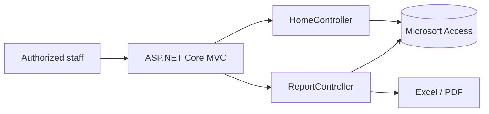

# Canteen — Employee Meal Attendance & Reporting

**ASP.NET Core MVC · C# · Microsoft Access · Excel / PDF Reports**


> **ตัวอย่างระบบรายงานการใช้บริการโรงอาหารพนักงาน** สำหรับค้นหาข้อมูลการเข้าใช้บริการตามวันและช่วงเวลา สรุปจำนวนครั้งและยอดค่าใช้จ่าย พร้อมส่งออกรายงาน Excel / PDF

A business application sample for reviewing **employee canteen usage** and preparing reports using ASP.NET Core MVC and a Microsoft Access database.

**Project status:** Portfolio / development code sample. A production deployment, complete data integration, and passing automated tests have **not** been independently verified.

---

## Features / ความสามารถที่พบในโค้ด

| Feature | Implementation |
| --- | --- |
| **Employee usage records** | Query employee code, name, department, date, time and related usage records |
| **Date-based filtering** | Retrieve canteen activity for a selected date range |
| **Daily summaries** | Aggregate usage counts and amounts from Access records |
| **Excel export** | Generate spreadsheet reports with ClosedXML |
| **PDF export** | Generate PDF reports with iText |
| **MVC interface** | Razor Views, report screens and controllers |

*The original project description refers to timestamp data originating from a fingerprint-scanning workflow. The code reviewed here reads data from an Access database; a live device integration has not been verified.*

## Technology stack

| Layer | Technology |
| --- | --- |
| Web application | C# / ASP.NET Core MVC |
| Target framework | `net7.0` |
| Database | Microsoft Access |
| Database access | OleDb / ODBC packages |
| Excel reports | ClosedXML |
| PDF reports | iText 7 |
| User interface | Razor Views and Bootstrap |

> **Maintenance note:** .NET 7 is out of support. Update the framework and dependencies, then retest database and reporting compatibility before a new deployment.

## How the application is organized



*High-level view of components in this repository; not a verified deployment diagram.*

## Repository structure

```text
Canteen/
├── Controllers/
│   ├── HomeController.cs       # Employee usage lookup
│   └── ReportController.cs     # Summary and report export
├── Services/
│   └── AccessDbService.cs
├── Models/
├── Views/
│   ├── Home/
│   └── Report/
├── wwwroot/
├── Program.cs
├── TLM_Canteen.csproj
└── README.md
```

## Local development

**Prerequisites:** a suitable .NET SDK, compatible Microsoft Access/OLE DB provider, and a **test-only** Access database with the tables and records expected by the application.

```bash
git clone https://github.com/pongapla/Canteen.git
cd Canteen
dotnet restore TLM_Canteen.csproj
dotnet build TLM_Canteen.csproj
dotnet run --project TLM_Canteen.csproj
```

Configure a local `AccessConnection` value using environment-specific settings instead of committing company database paths or credentials. Some Microsoft Access drivers and workloads require Windows and matching provider bitness.

The commands above are provided as setup guidance only; their successful execution has **not** been verified in this documentation update.

## Engineering and privacy notes

- Use **synthetic employee records** for screenshots, demos and public testing.
- Do not publish original scan logs, company files, internal server paths or personal employee data.
- Review access restrictions, validation, error handling and report-export behavior before production use.
- Verify licensing of third-party reporting libraries and review dependency updates.
- Replace unsupported framework versions and add automated tests when maintaining the codebase.

---

### Portfolio focus

**ASP.NET Core MVC · Microsoft Access integration · Business reporting · Excel / PDF export**

Developer: [Kittiphob Maynok](https://github.com/pongapla)
